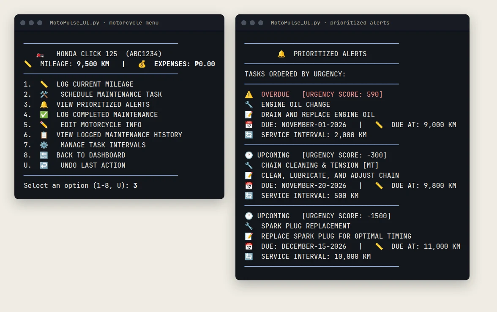

<div align="center">

# MotoPulse

**A terminal app that tracks motorcycle maintenance and ranks open jobs by how overdue they are.**


[](LICENSE)



<sub>A sample session with demo data: the overdue oil change ranks above the two upcoming jobs.</sub>

</div>

## What this shows
- A Python terminal app that ranks open maintenance jobs with a `heapq` priority queue, so the most overdue job comes first.
- An undo stack reverses recent actions, and everything saves to a local JSON file.
- Passwords and recovery answers are stored as SHA-256 hashes, never as text.

## Contents
- [What this shows](#what-this-shows)
- [About](#about)
- [Features](#features)
- [Run it](#run-it)
- [Project structure](#project-structure)
- [What I would change today](#what-i-would-change-today)
- [Changes after submission](#changes-after-submission)
- [License](#license)
- [Authors](#authors)

## About
You register an account, add your motorcycles by plate number and schedule maintenance tasks. MotoPulse ranks the open tasks by how overdue they are, so the job that needs doing first is at the top of the list. Two first-year BSIT students built it as a team project for a data structures course.

## Features
- **Accounts.** Register, log in and reset a password. Registration asks for a recovery question, and a reset is allowed only after the right answer. Passwords and answers are stored as SHA-256 hashes, never as text.
- **Motorcycles.** Add and edit them with plate, make, model, year and mileage.
- **Jobs.** Pick from nine standard jobs (oil change, chain, brake fluid and so on) or add your own. Each job remembers the interval you set, and a standard job offers its usual interval as the default the first time.
- **Priority queue.** Open tasks are ranked with `heapq`. Urgency adds the kilometres overdue to a date score: 10 points for each day overdue, 7 on the due date and 1 to 6 in the week before.
- **Service log.** Record completed work with its date and cost, and see the total spent per motorcycle.
- **Undo.** A stack reverses recent actions: new motorcycles, mileage updates, scheduled tasks, completed maintenance and edits.
- **Saving.** Everything goes to a local `motopulse_data.json` file.

## Run it
Python 3.8 or newer. No packages to install.

```bash
python MotoPulse_UI.py
```

Keep both files in the same folder. `MotoPulse_UI.py` is the menus, and `MotoPulse_UX.py` is the data model and the saving.

## Project structure

| File | Role |
|---|---|
| `MotoPulse_UI.py` | The menus: login, dashboard, motorcycle screens, date parsing and undo |
| `MotoPulse_UX.py` | The data model (users, motorcycles, tasks, service records), the priority queue and the JSON saving |

## What I would change today
- Passwords use plain SHA-256 with no salt. A real app needs a slow, salted hash such as bcrypt.
- Accounts created before the recovery question existed cannot reset a password, because they have no answer to check. A short answer is also easy to guess.
- Dates are typed as text and parsed against eleven formats. A date picker would be safer.
- Everything is in one JSON file, which is fine for a class project and not for real users.

## Changes after submission
The code is first-year coursework, shared as it was submitted apart from small edits and these changes:
- A header block, comments and docstrings in both files.
- The urgency score no longer falls to 0 on the due date. Before, a task due tomorrow outranked one due today.
- The completed-work prompt asks for the COMPLETION DATE. It used to say DUE DATE.
- Standard jobs offer their usual interval as the default.

## License
Released under the [MIT License](LICENSE).

## Authors
- **Evan Prens P. Exanes** · [GitHub](https://github.com/evanexanes) · [Portfolio](https://evanexanes.github.io/) · [Contact](https://evanexanes.github.io/07-contact.html)
- **Rhona-mae P. Prudenciado**

See the [case study](https://evanexanes.github.io/09-case-study-motopulse.html) on the portfolio.
